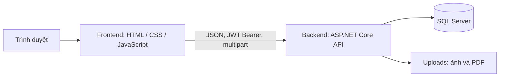

# Kiến trúc CourseFlow

## Hai ứng dụng độc lập

Frontend được build bằng Vite, phát hành thành file tĩnh. Backend được build/publish bằng .NET và chỉ xử lý API. Hai phần có package/project, cấu hình, lệnh chạy và đầu ra triển khai riêng.

## Phát triển trên máy

- Frontend: `http://localhost:5173`.
- API: `http://localhost:5106`.
- Trình duyệt gọi `/api`; Vite proxy chuyển request sang API và giữ nguyên Authorization/multipart.
- Có thể dùng `VITE_API_BASE_URL` để gọi API trực tiếp ở nguồn khác; backend cho phép qua danh sách CORS cụ thể.

## Luồng nghiệp vụ

1. Đăng nhập gửi email/mật khẩu đến `/api/auth/login`.
2. Backend xác minh password hash, tạo JWT chứa định danh và vai trò.
3. Frontend giữ JWT trong sessionStorage, gửi qua `Authorization: Bearer`.
4. Backend xác minh chữ ký, thời hạn, vai trò và quyền sở hữu khóa học.
5. Controller sử dụng service/repository hoặc DbContext theo nghiệp vụ hiện có để đọc/ghi SQL Server.
6. Frontend cập nhật giao diện theo phản hồi; các lỗi được hiển thị trong biểu mẫu hoặc thông báo.

Admin và Staff quản lý catalog toàn hệ thống. Instructor được tạo khóa và chỉ quản lý các khóa có `InstructorId` trùng định danh tài khoản; `StaffId` lưu nhân viên vận hành độc lập. User học qua quan hệ ghi danh. Quyền theo khóa áp dụng cả bài học, file và báo cáo tiến độ. Vai trò và SecurityStamp trong JWT được đối chiếu với database trên từng request xác thực.

Ảnh/PDF được tải qua API và lưu ngoài mã frontend. Quyền tải tài liệu phụ thuộc vào quyền quản lý hoặc trạng thái ghi danh. Dữ liệu tiến độ nằm trong SQL Server, không được mô phỏng trong trình duyệt.

## Ranh giới mã nguồn

| Thành phần | Trách nhiệm |
| --- | --- |
| `frontend/` | Trình bày, tương tác, điều hướng, validation giao diện và gửi HTTP. |
| `backend/OnlineCourseManagement.Api/` | Xác thực, phân quyền, nghiệp vụ, validation máy chủ, persistence và file. |
| `database/seeds/` | Các script dữ liệu thử nghiệm chạy thủ công. |
| `scripts/` | Điều phối chạy/build, không chứa nghiệp vụ. |
| `archive/legacy-razor/` | Mã Razor và thư viện tĩnh cũ được giữ để đối chiếu, không tham gia build hiện tại. |

Backend vẫn là một project ASP.NET với các thư mục chức năng; chưa chuyển sang kiến trúc nhiều project Domain/Application/Infrastructure. Frontend vẫn giữ JavaScript ES modules, chưa chuyển framework. Lần tái cấu trúc này tập trung làm rõ ranh giới FE/BE và khả năng chạy, build, triển khai riêng.

## Bảo toàn sau di chuyển

- Giữ nguyên `UserSecretsId`, namespace C# và toàn bộ migration.
- Giữ nguyên database và tên file trong `Uploads/`.
- Backend content root chuyển đến `backend/OnlineCourseManagement.Api/`, nơi chứa cả cấu hình và thư mục upload.
- Đường dẫn API `/api/...` được giữ nguyên; frontend chuyển sang cổng 5173.
- Các mẫu Razor cũ được lưu trong archive, backend không đăng ký Razor Pages hoặc phục vụ static frontend.
- `package-lock.json` ở gốc khóa dependency cho npm workspace frontend.

## Triển khai

Build frontend thành `frontend/dist/`; publish backend thành ứng dụng .NET riêng. Có thể dùng reverse proxy để hai ứng dụng xuất hiện dưới cùng một tên miền, hoặc cấu hình API URL và CORS khi sử dụng hai tên miền. File `Uploads/` cần được bố trí trên lưu trữ bền vững ở máy chủ API. Không đưa JWT signing key hoặc mật khẩu SQL Server vào cấu hình frontend.
