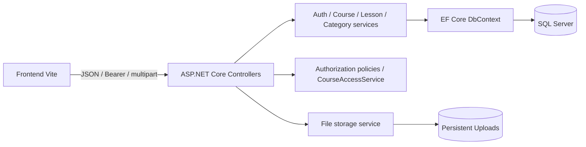
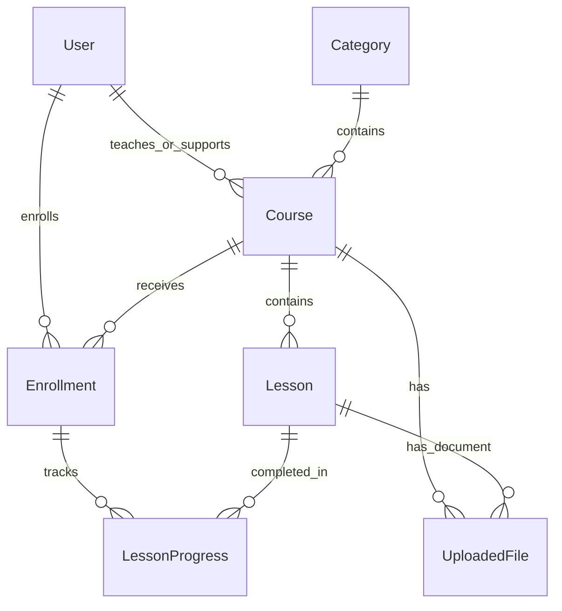

# Báo cáo kỹ thuật và kịch bản bảo vệ CourseFlow

Hướng dẫn thuyết trình từng slide, lời mở đầu, demo bốn vai trò và câu hỏi thường gặp: [project-presentation.md](project-presentation.md). Cài đặt/chuyển máy: [SETUP_GUIDE.md](../SETUP_GUIDE.md).

## Đề tài và mục tiêu

Thiết kế backend quản lý khóa học trực tuyến: tổ chức danh mục, khóa học, bài học, học liệu; quản lý tài khoản và phân công; ghi danh và lưu tiến độ. Dữ liệu lưu trong SQL Server, giao diện gọi API HTTP. Hệ thống hiện chưa có thanh toán hoặc kiểm tra nội dung video.

## Kiến trúc

Các service nghiệp vụ được đăng ký scoped cùng DbContext. Policy handler không giữ DbContext; nó kiểm tra principal và khóa được nạp trong phạm vi request. TimeProvider được inject để kiểm tra thời hạn token. Middleware ghi nhận request trước khi đi qua exception handler, CORS và xác thực/phân quyền.

Các controller hỗ trợ còn một số thao tác EF trực tiếp. Cấu trúc hiện tại là phân tầng trong một project, không trình bày như đã chuyển hoàn toàn sang Clean Architecture nhiều project.

## Mô hình dữ liệu

User.Email là duy nhất; Category.Name là duy nhất; Lesson có cặp CourseId/OrderIndex duy nhất. Một sinh viên không ghi danh trùng cùng khóa; một enrollment không có hai bản ghi tiến độ cho cùng bài. Course có hai quan hệ User độc lập: InstructorId và StaffId. Chi tiết quan hệ và hành vi xóa nằm trong AppDbContext/migration.

## Phân quyền và tính nhất quán

- Admin quản trị tài khoản, vai trò và phân công. Staff vận hành catalog và hỗ trợ tài khoản User. Instructor chỉ quản lý khóa được giao. User học nội dung đã ghi danh và cập nhật tiến độ của mình.
- Role xác định nhóm tài khoản; permission claims thể hiện quyền được server cấp; named policies kết hợp vai trò/quyền; resource policy kiểm tra khóa cụ thể.
- JWT được kiểm tra chữ ký, issuer/audience, thời hạn và trạng thái hiện tại của tài khoản. Đổi role/password tạo stamp mới để thu hồi token ngay.
- Admin có thể phân công hoặc bỏ từng phân công bằng FK nullable. Các thao tác phân công, tự tạo khóa, đổi role/password và xóa tài khoản phối hợp qua transaction/update lock; xung đột SQL trả 409. Kiểm thử đồng thời bảo đảm không để StaffId/InstructorId trỏ sang sai vai trò qua API.
- FE tải lại khi chuyển trang, nhấn làm mới hoặc quay lại cửa sổ; xác thực lại qua auth/me. Không cần đăng xuất/đăng nhập chỉ để nhận phân công mới; role/password thay đổi làm token cũ mất hiệu lực.
- Không xóa danh mục/khóa đang có quan hệ cần xử lý; không chuyển bài đã có tiến độ/tài liệu; xóa bài và tiến độ dùng một giao dịch SaveChanges.
- Upload kiểm tra dung lượng và chữ ký file, đặt tên GUID, từ chối tên lưu trữ có thể thoát thư mục.

## Bằng chứng kiểm thử

Ghi kết quả chạy trên máy bảo vệ bằng các lệnh trong [checklist](backend-checklist.md). Test .NET chạy không cần database; HTTP/SQL integration chạy trên database Development với fixture riêng và dọn sau khi thử. Không dùng dữ liệu production để chạy test tạo/xóa.

Các nhóm cần trình bày: cho phép/từ chối theo vai trò và khóa; dữ liệu còn lưu sau request; lỗi validation và ràng buộc trả đúng status; token bị thu hồi; download đúng phạm vi; log có traceId; dữ liệu gốc giữ nguyên sau test.

Kết quả kiểm tra trên máy Development ngày **22/11/2026**:

| Hạng mục | Kết quả |
| --- | --- |
| Build solution + frontend | Thành công; build .NET có 0 lỗi, 0 cảnh báo |
| xUnit backend | 52 test qua |
| Frontend/config/catalog | 25 test qua |
| HTTP/SQL authorization, auth lifecycle, CRUD, contracts, role sync | Cả 5 suite qua, đã dọn bản ghi QA |
| Đồng bộ quyền FE–API–SQL | Đối chiếu các hàm quyền FE với API/SQL; gồm 12 vòng thao tác đồng thời |
| Frontend kết nối backend | Đợt kiểm tra quyền ghi nhận 28 kiểm tra qua; cập nhật xác nhận đăng xuất có 10 kiểm tra auth/mất kết nối qua, gồm Hủy giữ phiên và xác nhận mới thoát |
| Kiểm tra quan hệ SQL | 0 phân công sai vai trò; 0 tiến độ/tài liệu chéo khóa |
| EF model và migration | Không có thay đổi model cần migration |
| Postman/Newman, lần kiểm tra trước cùng ngày | 27 request, 29 assertion qua; chưa chạy lại trong đợt kiểm tra quyền này |
| Publish Production cục bộ, lần kiểm tra trước cùng ngày | Catalog, health/readiness hoạt động; Swagger tắt; JWT key yếu làm khởi động thất bại |
| NuGet audit, lần kiểm tra trước cùng ngày | Không phát hiện package có cảnh báo theo nguồn audit tại thời điểm kiểm tra đó |
| Bảo toàn database | Số bản ghi và checksum của cả 7 bảng dữ liệu khớp trước/sau kiểm thử |

Dữ liệu gốc trong đợt kiểm tra quyền hiện tại: 1.004 tài khoản, 7 danh mục, 25 khóa học, 193 bài học, 2 ghi danh, 2 tiến độ và 2 metadata file; được giữ nguyên sau khi dọn QA. 1.000 tài khoản seed dùng hash giả nên cần tạo tài khoản thật hoặc Admin đặt lại mật khẩu cho tài khoản dùng demo. Các con số là bằng chứng lần chạy trên máy này, không thay cho chạy lại khi đổi mã nguồn/môi trường. Workflow GitHub Actions đã được chuẩn bị; chưa xác nhận kết quả CI trên GitHub cho thay đổi chưa push.

## Lỗi phát hiện và sửa trong đợt kiểm tra quyền

1. Giảng viên vẫn thấy khóa cũ khi Admin phân công lại ở phiên khác: đã tái hiện bằng browser, sửa cập nhật dữ liệu khi điều hướng/quay lại cửa sổ và kiểm tra phiên hiện tại.
2. Không có cách đưa khóa về trạng thái chưa phân công: bổ sung null trong DTO/service và lựa chọn Bỏ phân công ở FE, giữ độc lập StaffId/InstructorId. Không đổi schema.
3. Đổi vai trò và phân công đồng thời có thể trả 500 do deadlock được EF bọc trong exception khác: thống nhất update lock trên tài khoản và nhận diện xung đột trong chuỗi exception để trả 409. Tự tạo khóa cũng kiểm tra lại role/stamp trong giao dịch để bảo vệ quan hệ tự phân công.
4. Hướng dẫn cũ mô tả nhầm npm cài NuGet, migration tạo Admin và cách đăng nhập Swagger; còn ví dụ vai trò Student/hash giả. SETUP_GUIDE.md đã được chỉnh đúng theo mã hiện tại.

Trong SSMS, mở `database/queries/AuditPermissions.sql`. Các truy vấn phân công sai vai trò, tiến độ chéo khóa và tài liệu chéo khóa phải trả 0 dòng. Không dùng `SELECT * FROM Users` khi trình chiếu.

## Kịch bản demo khoảng 10 phút

1. Giới thiệu cây thư mục FE/BE/database và sơ đồ dữ liệu; chỉ rõ controller–service–EF trong khóa học.
2. Mở Swagger, đọc catalog không cần token; gọi endpoint phân trang, lọc giá và đổi cách sắp xếp.
3. Đăng nhập Admin, Authorize; tạo danh mục/khóa/bài QA. Mở SSMS chạy SELECT để thấy dữ liệu đã lưu.
4. Thử xóa khóa còn bài để nhận 409; thử request dữ liệu sai để nhận 400 có errors/traceId.
5. Phân công giảng viên; dùng hai giảng viên để chứng minh người phụ trách sửa được và người còn lại nhận 403.
6. Đăng ký sinh viên, ghi danh, hoàn thành bài; tải lại tiến độ từ API/SQL. Tài khoản chưa ghi danh bị chặn khi đọc nội dung.
7. Thử upload PDF thật và file đổi đuôi giả để chứng minh kiểm tra chữ ký. Xóa file thử sau demo.
8. Đổi role/reset password tài khoản QA; gọi lại bằng token cũ để nhận 401. Không dùng tài khoản Admin đang bảo vệ để tự hạ quyền.
9. Chạy test, chỉ kết quả build/publish và JSON log tương ứng X-Request-ID.
10. Dọn bản ghi QA theo đúng quan hệ, xác nhận dữ liệu ban đầu còn nguyên.

## Câu hỏi giải thích

**Vì sao kiểm tra quyền ở backend?** Người gọi có thể gửi request trực tiếp bằng Postman; việc ẩn nút trên frontend không cấp hoặc thu hồi quyền API.

**JWT chưa hết hạn có thể bị thu hồi không?** Có. API đối chiếu role và SecurityStamp trong database trên mỗi request xác thực.

**Vì sao cần cả validation và unique index?** Validation giúp trả lỗi dễ hiểu trước khi ghi; unique index bảo vệ khi có request đồng thời hoặc thao tác trực tiếp từ SQL.

**Migration khác seed thế nào?** Migration quản lý schema/ràng buộc. Seed nạp dữ liệu mẫu. Chạy lại seed sau khi xóa mẫu có thể thêm lại phần thiếu.

**File có lưu trong SQL không?** SQL giữ metadata và quan hệ; nội dung ảnh/PDF nằm trong thư mục lưu trữ được cấu hình. Cần sao lưu cả hai.
