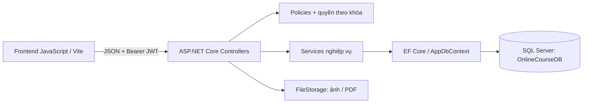

# Hướng dẫn báo cáo và demo CourseFlow

Đề tài 3: **Thiết kế Back-end cho hệ thống Quản lý Khóa học Trực tuyến**.

## 1. Phần mở đầu có thể nói trực tiếp

> Đề tài của em xây dựng backend cho hệ thống quản lý khóa học trực tuyến. Backend sử dụng C#, ASP.NET Core Web API trên .NET 10, Entity Framework Core và SQL Server. Frontend JavaScript/Vite là ứng dụng độc lập, gọi API để hiển thị và thao tác dữ liệu. Hệ thống có bốn vai trò: Admin, nhân viên, giảng viên và sinh viên. Điểm em tập trung là phân quyền tại server, quản lý quan hệ dữ liệu, ghi danh và tiến độ học tập, cùng khả năng kiểm thử lại các tình huống cho phép và bị từ chối.

Giải thích tên: mã lưu trong database/API là `Admin`, `Staff`, `Instructor`, `User`. **Sinh viên là `User`**, không gửi vai trò `Student` cũ. SQL Server là hệ quản trị database; SSMS là công cụ mở và truy vấn database đó.

## 2. Bố cục 10–12 slide

| Slide | Nội dung nên đưa lên | Phần cần giải thích bằng lời |
| --- | --- | --- |
| 1 | Tên đề tài, thành viên, giảng viên hướng dẫn | Mục tiêu xây dựng backend và phạm vi |
| 2 | Bài toán: nội dung khóa học, tài khoản, ghi danh, tiến độ | Ai dùng hệ thống và thao tác gì |
| 3 | Công nghệ: C#, ASP.NET Core/.NET 10, EF Core, SQL Server, JWT; FE Vite | Phân biệt backend, frontend và database |
| 4 | Sơ đồ FE → Controllers → Services/Authorization → EF → SQL | Request HTTP đi qua những lớp nào |
| 5 | ERD: 7 bảng ứng dụng | Nêu hai FK StaffId/InstructorId, Enrollment và Progress |
| 6 | Ma trận bốn vai trò | Giảng viên có phạm vi theo khóa; Staff quản lý toàn catalog |
| 7 | Luồng đăng ký, đăng nhập và thu hồi JWT | Hash có salt, token được đối chiếu với role/stamp hiện tại |
| 8 | Các nhóm API và status HTTP | 400 validation, 401 phiên không hợp lệ, 403 thiếu quyền, 409 xung đột/ràng buộc |
| 9 | Tính nhất quán dữ liệu | Unique index, FK, giao dịch, bảo vệ phân công/đổi vai trò đồng thời |
| 10 | Bằng chứng kiểm thử | Kết quả thực tế trong backend-report.md và role-sync suite |
| 11 | Demo bốn vai trò trên FE, Swagger và SSMS | Thực hiện theo phần 5 bên dưới |
| 12 | Kết quả, giới hạn, hướng phát triển | Không nhận đã có những chức năng chưa triển khai |

Không cần đưa toàn bộ source lên slide. Chuẩn bị sẵn 3–4 file để mở khi được hỏi: `Program.cs`, `Security/AppPolicies.cs`, `Services/CourseService.cs`, `Data/AppDbContext.cs` trong backend.

## 3. Kiến trúc và dữ liệu để giải thích



Hiện dự án phân tầng trong một project API. Users/Enrollments/Progress còn một số thao tác EF trực tiếp trong controller; không mô tả như đã tách hoàn toàn thành Clean Architecture nhiều project. `Repositories/UserRepository.cs` phục vụ truy vấn người dùng; các service catalog dùng DbContext trực tiếp.

| Bảng | Vai trò |
| --- | --- |
| Users | Tài khoản, email duy nhất, role, hash mật khẩu, stamp bảo vệ phiên |
| Categories | Danh mục; tên không trùng |
| Courses | Khóa học; CategoryId, InstructorId, StaffId; hai người phụ trách độc lập và có thể NULL |
| Lessons | Bài học; không trùng cặp CourseId/OrderIndex |
| Enrollments | Sinh viên ghi danh; không trùng cặp StudentId/CourseId |
| LessonProgresses | Hoàn thành bài; không trùng cặp EnrollmentId/LessonId |
| UploadedFiles | Metadata học liệu, người upload, quan hệ khóa/bài; nội dung file nằm trên ổ đĩa |

Ngoài 7 bảng nghiệp vụ, EF quản lý bảng lịch sử `__EFMigrationsHistory`.

## 4. Ma trận quyền cần nhớ

| Thao tác | Admin | Staff | Instructor | User/sinh viên |
| --- | --- | --- | --- | --- |
| Tài khoản và phân quyền | Quản trị | Xem/hỗ trợ User | Không | Chỉ hồ sơ của mình |
| Danh mục | CRUD | CRUD | Chỉ xem | Chỉ xem |
| Tạo khóa | Có | Có, tự gán StaffId | Có, tự gán InstructorId | Không |
| Khóa/bài/học liệu | Tất cả | Tất cả | Chỉ khóa được giao | Học/tải sau ghi danh |
| Phân công hoặc bỏ phân công | Có | Không | Không | Không |
| Báo cáo học viên | Tất cả | Tất cả | Chỉ khóa được giao | Tiến độ của mình |
| Ghi danh/đánh dấu hoàn thành | Không | Không | Không | Có |
| Đặt lại mật khẩu | Mọi tài khoản | Chỉ User | Không | Không qua màn hình quản trị |

`StaffId` dùng theo dõi người vận hành; nó không giới hạn Staff vào chỉ một nhóm khóa. Instructor được giới hạn bằng `Course.InstructorId`. Ẩn nút ở FE chỉ giúp trải nghiệm; gọi request trực tiếp vẫn phải qua policy tại BE.

## 5. Demo thực tế khoảng 12–15 phút

### Chuẩn bị trước khi vào báo cáo

1. Chạy `npm.cmd run dev`; mở FE `http://localhost:5173`, Swagger `http://localhost:5106/swagger` và SSMS vào `.\SQLEXPRESS` / `OnlineCourseDB`.
2. Dùng Admin thật đang đăng nhập được. Trong **Tài khoản**, tạo 4 tài khoản có tên dễ nhận: `DEMO Nhân viên`, `DEMO Giảng viên A`, `DEMO Giảng viên B`, `DEMO Sinh viên`. Tự chọn mật khẩu riêng, không đưa lên slide/Git.
3. Dùng cửa sổ thường và cửa sổ riêng tư hoặc các hồ sơ trình duyệt riêng để đăng nhập nhiều vai trò. Không chỉ dùng nhiều tab chung `sessionStorage` đã sao chép mà không kiểm tra lại tài khoản hiện tại.
4. Đặt tên dữ liệu thử bắt đầu `DEMO`, ghi lại ID. Mở sẵn `database/queries/AuditPermissions.sql`; file chỉ đọc và không hiển thị hash/stamp.
5. 1.000 tài khoản seed cũ dùng hash giả để thử danh sách/phân trang; **không dùng chúng để demo đăng nhập**. Tạo tài khoản qua FE/Admin, hoặc đặt lại mật khẩu cho đúng tài khoản muốn sử dụng.

### Trình tự thao tác và câu giải thích

| Phút | Thao tác trực tiếp | Cần chứng minh |
| --- | --- | --- |
| 0–2 | Admin tạo danh mục `DEMO`, khóa miễn phí, một bài học | FE gửi API; SSMS chạy SELECT thấy bản ghi, không phải dữ liệu giả trên trình duyệt |
| 2–3 | Admin phân công Staff và Giảng viên A | SQL Courses có StaffId/InstructorId đúng người, hai cột độc lập |
| 3–5 | Staff mở khóa, sửa bài; mở Sinh viên | Staff quản lý catalog nhưng không có nút tạo/xóa/phân quyền tài khoản hay phân công |
| 5–7 | Giảng viên A mở Khóa tôi giảng dạy, thêm bài/PDF; Giảng viên B mở cùng khóa | A sửa được; B không có thao tác sửa, API từ chối nếu gọi trực tiếp |
| 7–9 | Sinh viên mở bài trước ghi danh, sau đó ghi danh rồi mở bài, đánh dấu hoàn thành | Trước ghi danh bị chặn; sau ghi danh tiến độ lưu thật, giảng viên thấy trên báo cáo |
| 9–10 | Admin chuyển khóa từ A sang B; quay lại cửa sổ A hoặc chuyển trang | A mất quyền, B nhận quyền; FE tải lại phân công và BE kiểm tra dữ liệu hiện tại |
| 10–11 | Admin chọn Bỏ phân công rồi lưu | Cột tương ứng thành NULL, người còn lại và nội dung khóa vẫn giữ nguyên |
| 11–12 | Dùng token sinh viên trong Swagger gọi quản lý, hoặc token cũ sau reset password | 403 cho thiếu quyền; 401 cho token bị thu hồi |
| 12–13 | Thử xóa khóa còn bài / danh mục còn khóa | 409 bảo vệ quan hệ dữ liệu, không mất nội dung |
| 13–15 | Mở kết quả test và truy vấn SQL kiểm tra quan hệ | Bằng chứng kiểm thử cho phép/từ chối và tính nhất quán |

Trong Swagger: gọi `POST /api/auth/login` trước, sao chép **giá trị token** từ response, nhấn **Authorize** và dán token. Swagger dùng scheme HTTP Bearer, không có form đăng nhập email/mật khẩu tại nút Authorize. Không chiếu token trên bản báo cáo công khai.

### Truy vấn SQL minh họa an toàn

```sql
USE OnlineCourseDB;
SELECT TOP (10) Id, FullName, Email, Role, CreatedAt
FROM dbo.Users ORDER BY Id DESC;

SELECT c.Id, c.Title, c.StaffId, staff.FullName AS StaffName,
       c.InstructorId, teacher.FullName AS InstructorName
FROM dbo.Courses c
LEFT JOIN dbo.Users staff ON staff.Id = c.StaffId
LEFT JOIN dbo.Users teacher ON teacher.Id = c.InstructorId
WHERE c.Title LIKE N'DEMO%';

SELECT e.Id AS EnrollmentId, e.StudentId, e.CourseId,
       p.LessonId, p.IsCompleted, p.CompletedAt
FROM dbo.Enrollments e
LEFT JOIN dbo.LessonProgresses p ON p.EnrollmentId = e.Id
JOIN dbo.Courses c ON c.Id = e.CourseId
WHERE c.Title LIKE N'DEMO%';
```

SSMS không tự làm mới kết quả SELECT cũ; chạy lại F5 sau thao tác FE. Không chạy lại seed để kiểm tra xóa vì seed có thể thêm lại mẫu thiếu.

### Dọn dữ liệu DEMO

Sinh viên hủy ghi danh để xóa tiến độ của lần học thử. Người có quyền xóa tài liệu/ảnh thử, rồi bài học, khóa học và danh mục DEMO. Sau khi giải phóng mọi phân công và quan hệ, Admin có thể xóa tài khoản DEMO. Không xóa hàng loạt hoặc chạy script reset database trước buổi bảo vệ.

## 6. Các câu hỏi thường gặp

**Backend có còn là .NET Core không?** Có: C# và ASP.NET Core Web API, target .NET 10. JavaScript là frontend và công cụ kiểm thử; không thay backend bằng Node.js.

**Thêm/sửa/xóa ở FE có cập nhật SQL không?** FE gửi HTTP đến controller; nghiệp vụ và quyền được kiểm tra tại BE; EF SaveChanges ghi vào SQL. Có test đọc SQL độc lập để đối chiếu.

**Vì sao không cho người dùng chọn Admin khi đăng ký?** Đăng ký công khai chỉ tạo User. Vai trò đặc quyền do Admin tạo/cấp, tránh tự nâng quyền bằng sửa request.

**Role, claim, policy khác nhau thế nào?** Role là nhóm tài khoản; permission claim do server phát hành biểu thị quyền; policy kiểm tra role/claim và resource policy kiểm tra khóa cụ thể.

**Giảng viên đổi ID khóa trong request có sửa khóa khác được không?** Không. BE nạp khóa từ SQL và so InstructorId với định danh đã xác thực; chuyển bài còn kiểm tra cả khóa nguồn/đích.

**JWT còn hạn nhưng đã đổi quyền thì sao?** API đối chiếu role và SecurityStamp trong SQL trên mỗi request xác thực. Token cũ nhận 401. Đổi phân công cũng được kiểm tra trực tiếp theo khóa ở request tiếp theo.

**Vì sao dùng cả validation và unique index/FK?** Validation trả thông báo sớm; ràng buộc DB vẫn bảo vệ dữ liệu khi request chạy đồng thời hoặc có truy cập SQL khác.

**Nếu vừa đổi vai trò vừa phân công?** Các thao tác dùng transaction và update lock trên cùng tài khoản; nếu xảy ra xung đột SQL thì trả 409 để thử lại. Không lưu người có vai trò User vào cột giảng viên/nhân viên qua API.

**Bỏ phân công có xóa tài khoản hay bài học không?** Không. Chỉ đặt FK tương ứng về NULL; người phụ trách còn lại, nội dung và ghi danh vẫn giữ nguyên.

**Mật khẩu/file lưu thế nào?** Mật khẩu là hash PBKDF2 có salt qua PasswordHasher. SQL chỉ lưu metadata file; ảnh/PDF nằm trong thư mục cấu hình. Không dùng SELECT * Users khi trình chiếu.

**EF Code First là gì?** Entity và cấu hình DbContext định nghĩa model; migration tạo/cập nhật schema. Seed là nạp dữ liệu và là lệnh riêng.

**Tại sao giao diện có thể khác sau khi đổi phân công ở máy khác?** Dữ liệu cập nhật khi chuyển trang, nhấn làm mới hoặc quay lại cửa sổ. Chưa có WebSocket đẩy dữ liệu liên tục; BE luôn chặn quyền cũ dù FE chưa tải lại.

## 7. Lệnh và bằng chứng kiểm thử

```powershell
npm.cmd run build
npm.cmd test
npm.cmd run test:backend
# Cần API + SQL, chạy lần lượt:
npm.cmd run test:authorization
npm.cmd run test:roles
npm.cmd run test:auth
npm.cmd run test:crud
npm.cmd run test:contracts
```

`test:roles` nhập các hàm quyền thật của FE, gọi BE và kiểm tra SQL, gồm phân công/bỏ phân công, thu hồi token và các tình huống đồng thời. Các test chỉ sửa fixture QA; checksum 7 bảng được đối chiếu trước/sau. Kết quả cụ thể được cập nhật trong [báo cáo backend](backend-report.md) và [kiểm tra logic](logic-audit.md).

## 8. Phạm vi và hướng phát triển

Đã có quản lý nội dung, bốn vai trò, học liệu, ghi danh, tiến độ, JWT, migration, validation, phân trang, logging, CORS, Swagger và hướng dẫn publish.

Chưa có thanh toán, gửi email xác thực/quên mật khẩu, kiểm tra chất lượng nội dung video, chứng chỉ, WebSocket hoặc kiểm thử tải production. Định hướng tiếp theo: các tính năng này, chia nhỏ app.js và hoàn thiện phân tầng các controller hỗ trợ. Chỉ nói CI/deploy production đã chạy thành công khi có kết quả thực tế tương ứng; có workflow/publish profile không đồng nghĩa đã triển khai công khai.
